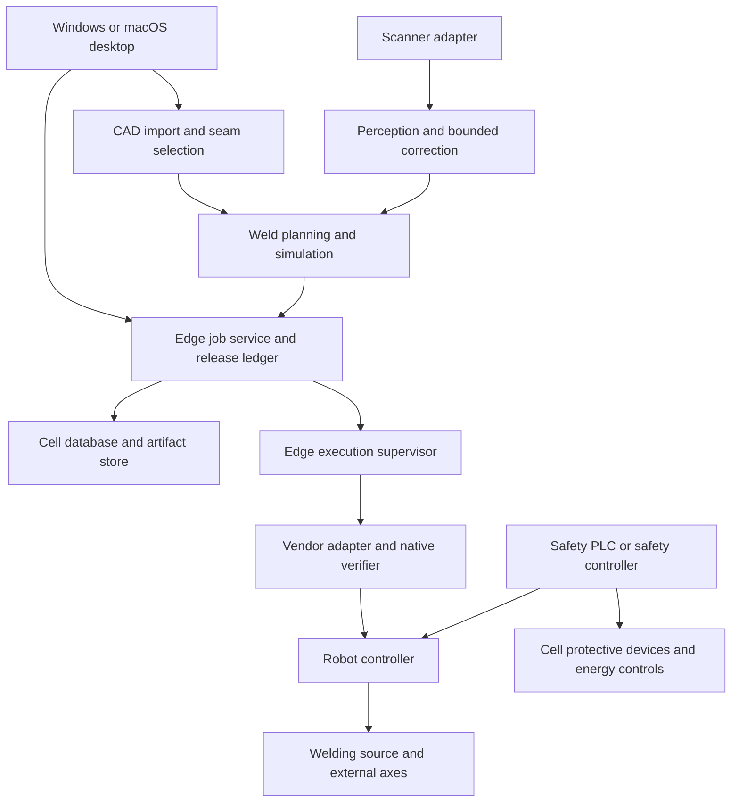
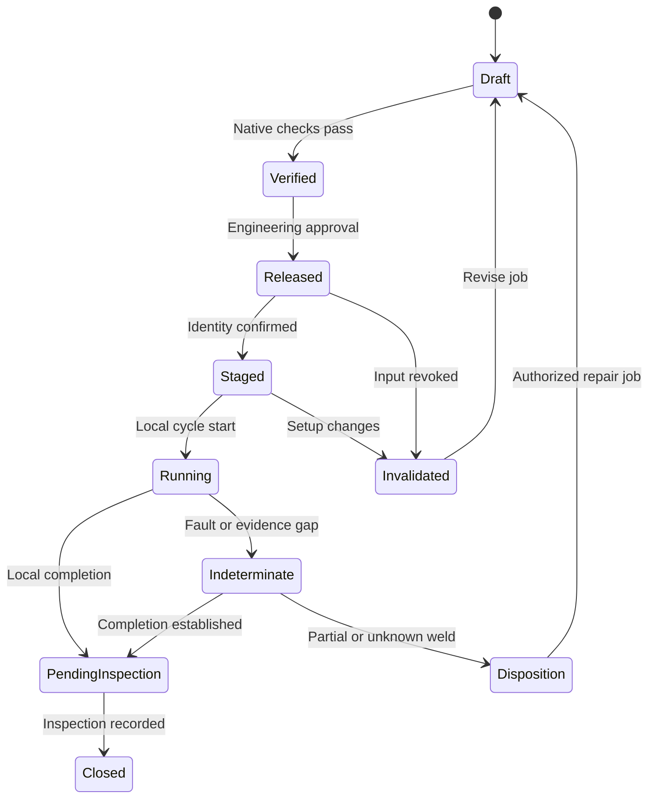

# KERobot | Autonomous robotic welding platform
**Architecture and development plan · 23 November 2026 · Proposed engineering baseline**

## 1. Executive summary

Build a workstation that lets an operator select a seam on a STEP assembly and release a **specific, inspected native robot program for a specific physical setup**. Keep CAD, planning and review identical on Windows and macOS. Put acquisition, vendor tooling, artifact verification and job supervision on a cell-side industrial PC. Keep interpolation, arc sequencing and external-axis synchronization on the controller. The integrator owns the independent safety system. An engineering release authorizes a local operator to initiate a cycle under the cell procedure.

**First production scope.** One guarded cell, one approved single-pass straight T-fillet procedure, one fixture family, one fixed pre-weld scanner, and a track at one verified station. Start with the reported ABB IRB 4600-20/2.50, IRC5, Güdel track and Lincoln Power Wave R450. Use an existing known-good controller routine as the reference. A simulation MVP works from replay files before a scanner or controller interface is purchased. The pilot adds physical scanning, native program verification, local cycle start and inspection on coupons. Multi-pass work, coordinated track travel and in-arc tracking each require a new qualification.

**Highest risks, in order.** (1) A plausible alignment on the wrong symmetric face can place a sound trajectory on the wrong seam. Use an independent datum, local evidence along the seam and a reject path. (2) A generic simulation can differ from the controller at blends, wrist flips and transitions. Verify the generated native artifact, then prove the swept path and clearance physically. (3) A digital recipe can select the wrong installed power-source mode. Bind the WPS to a proven machine schedule and verify selection at the cell. (4) A job interrupted after ignition can be welded twice. Preserve segment history and require a welding-engineer disposition wherever completion is uncertain.

**Success measure.** Compare programming time and first-article acceptance against the present teach-pendant process on matched parts. Publish rejected setups and manual intervention as well as time saved. Production release depends on signed engineering, quality and site acceptance evidence.

## 2. Assumptions and open questions

| Assumption used for design | Decision it affects | Who resolves it and with what evidence |
|---|---|---|
| A1. Existing ABB/Lincoln equipment is accessible for a scheduled pilot. Its options, calibration and physical arrangement remain unverified. | Choice of native postprocessor, Windows adapter and transfer method | Controls lead inventories nameplates, controller and source backups, RobotWare build, installed options, feeder and interface manuals. Compare to a working program and actual I/O map. |
| A2. An existing fixture can hold one family of steel T-joints within an approved fit-up range. The track can remain at a single verified location throughout the cycle. | Six-axis first release and permissible working volume | Integrator surveys the station, verifies the external-axis coordinate and effective means to keep it there. If position cannot be assured, redesign the pilot before motion. |
| A3. The welding authority can supply a released WPS and a contractual inspection route for these parts. | Whether welding can begin and which parameters an operator can select | Welding engineer identifies the governing code, qualification evidence, material group, thickness, position, wire, gas, process, joint detail and acceptance criteria. A trial sheet supplies observations only. |
| A4. A fixed sensor can see the joint faces, endpoints, datum and relevant clamps on representative finishes. | Sensor choice, mounting, scanning time, positional error budget | Vision lead runs a metrology-backed loaner trial across shiny, oxidized and occluded parts. If coverage fails, change view or fixture, or qualify a mounted scanner separately. |
| A5. Pilot CAD has exact faces and assembly transforms, preferably exported as STEP AP242. | Joint selection, identity after reimport and geometry kernel | CAD owner supplies known-good, defective and revised samples from actual CAD exporters, with drawings and trusted dimensions. |
| A6. One edge node owns one cell. Air-gapped operation, Windows x64 and Apple silicon desktop support matter first. | Single-writer database, licensing, installation and OS test matrix | IT approves hardware, offline activation, OS versions, GPU policy, signing and backup destination. Confirm whether Intel Mac or older Windows versions are contractual. |
| A7. Saudi Arabia is the likely first site. US and EU entries below are expansion scenarios. | Regulatory classification, data residency, language, responsibility for retrofit | Site owner names jurisdiction, intended use, integrator/manufacturer of record, customer codes and data-handling restrictions. |

Before pricing or committing dates, settle target part envelope, seam quality tolerance, required throughput, retention, support lifetime, acceptable outage and permitted controller access. Product owns the baseline, welding/quality owns tolerances and IT owns recovery objectives. Record each unresolved value with an owner, required experiment and decision gate.

## 3. User workflows

| Step | Operator experience | What the system records or checks |
|---|---|---|
| 1. Create job | Enter JOBID, part revision, quantity and cell. Open assembly, check units against a drawing dimension, confirm assembly orientation. | Source SHA-256, importer settings, assembly tree, occurrences and warnings. Missing or unresolved units require confirmation. |
| 2. Confirm joints | Select candidate, inspect highlighted mating faces and endpoints, choose the weld side and travel direction. Trim or reject it. | Explicit selection and reason. Geometric contact suggests a joint, while weld intent comes from drawing or authorized user. No weld intent inferred from contact alone. |
| 3. Bind procedure | Pick a released WPS and machine schedule permitted for the joint. Preview torch posture on both sides. | Check material, thickness, weld position, size and ranges. Show travel and wire-feed speeds with distinct units. Reject unsupported weave, pass or source mode. |
| 4. Set up | Fixture part, identify clamp state, verify tool/TCP, consumables, work return and station. | Local guided checklist plus wired feedback where installed. Label manual checks with operator and time. |
| 5. Scan and reconcile | Trigger the approved scan sequence. Inspect scan/CAD overlay, seam evidence, coverage gaps, unexpected objects and corrections by location. | Pin capture and pose, preserve raw data, derive fresh obstacle occupancy. Changing a clamp, part or station invalidates the scan. |
| 6. Simulate and release | Review scan-corrected approaches, weld, retract, transitions, clearance and risks. Engineer reviews the native-program verification; authorized user signs the exact package. | Unresolved blockers disable release. Bind snapshot, postprocessor, program, verification report and approvals to job and cell. |
| 7. Stage and run | At the cell confirm JOBID, part and staged revision. Authorized local operator starts through commissioned controls. | Verify loaded identity and preconditions, record controller acknowledgement, segment progress, source feedback and faults. |
| 8. Close | Inspect the part, associate inspection result and disposition; compare commanded and measured process data where available. | Completed cycle and quality acceptance are different states. Preserve rejects, repairs, missing feedback and sign-off. |

**Recovery belongs to the workflow.** Low coverage or ambiguous alignment prompts a new view, datum check or refixture followed by a new scan. A wrong material or fit-up goes to quality for disposition. A calibration mismatch blocks release until an independent check or recalibration succeeds. A clamp change after approval invalidates affected artifacts. A lost acknowledgement moves execution to *indeterminate* until local controller state and operator evidence reconcile it. After a partial weld, record the completed, suspect and untouched intervals; quality authorizes any repair procedure. A new local start is required. The UI must show the precise blocker, affected seam and evidence needed to clear it.

## 4. Functional and non-functional requirements

“MVP” is the first cell capability. The earlier simulation milestone exercises the same contracts with replay inputs.

| Capability | MVP | Next release | Later |
|---|---|---|---|
| Geometry and weld intent | STEP solid assemblies, inspected units, face/edge picking, straight T-fillet suggestions, trim, side, direction and rejection | Curves, more joint families, qualified IGES repair and drawing annotation linking | Licensed proprietary CAD translation driven by customer samples; qualified PMI interpretation |
| Procedure and geometry | Versioned approved WPS, separate machine schedule, work/travel angles, orientation, approach/retract, explicit process phases and sequence; single stringer pass | Qualified weave profiles, stitch sequences, reverse travel, corner and end strategies | Multi-pass layer and bead offsets with interpass constraints and revalidation |
| Twin | Measured tool, torch, stickout, fixture, clamps, robot, base, table, scanner, fixed track position, process/safety-zone overlays, collision pairs and clearance reports | Cleaning station, positioner index positions, measured cable envelopes and route variants | Coordinated external-axis planning and qualification per group |
| Adaptation | Fixed scan before arc, rigid placement plus bounded local correction where qualified; rejection and replay | Mounted multi-view scan or separately qualified touch sensing, between-pass rescan | Controller-supported seam tracking with validated authority, failure response and dynamic envelope |
| Operations | Offline authoring, staging, local cycle initiation, roles, events, weld records, local backup/restore, signed manual update | Controlled support export, outbound updates/backups, fleet inventory and production reporting | Cross-site job distribution subject to cell-specific verification |
| Quality of service | Responsive review on both OSs, separate heavy workers, durable state changes, fresh status, explicit missing data, one execution owner | Validated capacity and availability on a broader hardware matrix | Multi-cell scheduling and site-level analytics |

**Performance and evidence.** Establish budgets during discovery using the actual CAD corpus, cell, largest nominated scan, reference computers and baseline manual cycle. Measure cold/warm import time, peak memory, picking latency, scan-to-review time, worst-case validation time, telemetry age, alarm delay, disk growth, and offline restore time. Record median, tail and failures by input class, including deadlines missed. Require the signed targets on both desktop platforms and the selected edge before acceptance. Any worker may time out or cancel without authorizing motion. Cache derived artifacts by content hash and builder version. Keep timing for servo interpolation, external-axis coordination, tracking control and safety reactions on their validated local systems. Site integrator derives and measures safety response and stopping distance under worst applicable load, speed and position. No desktop or network round trip is part of that budget.

## 5. System architecture



| Component / owner | Responsibility and boundary |
|---|---|
| Desktop and CAD worker | UI presents the operator workflow. A restricted native worker parses untrusted CAD with time and memory limits. Preserve B-rep, assembly occurrences, units, healing changes and separate display meshes. Mesh decimation cannot change the seam definition. |
| Planner | Creates a vendor-neutral typed motion and process plan from geometry and WPS. Define the seam tangent by travel direction, derive face normals on the chosen side and apply the signed work/travel convention. Use direction-aware fixture tests for left/right welds; wrist joint values alone cannot define a work angle. Solve continuous joint branches, check limits, wrist singularities, reach and clearance through transitions. Report the obstructing bodies, interval and minimum clearance. |
| Twin and native verifier | Use measured geometry and conservative swept volumes, including brackets, torch package and dress pack. Model uncertainty and unknown occupied regions. Recheck welding, transfer, cleaning and recovery paths. Native verifier loads the emitted program and pinned cell configuration in matching vendor tooling, checks warnings, frames, configuration branches, blends, speeds and external groups. Report approximations and state what requires physical proof. |
| Perception | Stores raw captures, calibration and capture poses. Produces registration, uncertainty, local seam measurements, observable regions and obstacles. It proposes corrections for independent planning, simulation and approval. |
| Job service | Sole writer for releases, operator roles, procedure revisions and job transitions. In disconnected authoring mode, the desktop owns a draft workspace. Importing a draft onto an edge creates a revision and requires fresh validation against that cell. |
| Supervisor and adapters | Supervisor stages and reconciles a released package, with a single per-cell execution lease and fencing generation. Adapters translate only declared capabilities, isolate SDK faults and report actual feedback quality. The native program/PLC owns local sequencing, watchdog responses and the process handshake. |
| Optional DMZ service | Site-controlled outbound relay for signed update retrieval, encrypted backups and approved support bundles. Remote visibility is read-only in the proposed scope. No cloud dependency for running, recovery or approval. |

**Deployment.** Identical signed desktop clients run on engineering PCs and Macs. Run a service-managed gateway on an industrial Windows x64 PC for the pilot, subject to the supported SDK/OS matrix. Use a separate licensed Windows engineering station or controlled VM for RobotStudio/virtual-controller checks if supported; exchange verification evidence by job hash. A future Linux acquisition worker can run a Linux-only SDK over the same adapter contract. Place HMI/engineering access, OT devices and enterprise/DMZ services on defined network segments and allowlist only required flows; disable IP forwarding on a multi-interface edge. Protective devices connect through the independent commissioned safety architecture.

**Data flow and trust.** CAD → confirmed seam + WPS → nominal plan; scan + calibration → placement + obstacles + per-seam correction → corrected plan → native build → exact-artifact validation → signed release → edge staging and identity check → local start → controller events + process and inspection records. The preview may run locally on either desktop. The authoritative build and release use pinned tool versions and recorded inputs. Large files travel as resumable, hash-verified objects; small commands and ordered events use versioned APIs. Neither a preview nor connectivity to an edge grants execution rights.

**Operating-system parity.** Both desktops can import, plan, replay, simulate generically, compare revisions, review native verification evidence, approve if authorized and monitor the edge. Direct ABB SDK access, RobotStudio and any Windows-only utilities stay on a supported Windows host. Scanner capture stays beside the hardware on the vendor-supported OS/GPU/driver combination. Physical start, safety reset and teach operations stay at commissioned cell controls irrespective of desktop OS. ABB documents PC Interface option 616-1 for its IRC5 PC SDK path and publishes RobotStudio's OS requirements. Scanner SDK system requirements must be checked independently. [1][s1], [2][s2], [3][s3]

**Planning details.** For each seam sample, build a right-handed frame from the travel tangent and the selected pair of surface normals. Apply the procedure’s work angle, travel angle, tool-center-point definition and contact-tip-to-work distance. Draw the result as an actual torch and wire on the selected side. Choose a continuous inverse-kinematics solution across the seam and its lead-in/lead-out. Preserve orientation through corners only within validated limits. Mark the intentional wire/workpiece interaction for the weld segment specifically; keep nozzle, torch body, clamps, fixture and external-axis links in the collision checks. For future coordinated motion, solve arm and external groups jointly against rail limits, velocity, acceleration, cable constraints and station calibration, then verify the emitted native group motion. A parked-axis proof cannot qualify that feature.

**Execution state model.** A release digest identifies an approved plan. An attempt ID identifies one physical execution of it. Persist both before staging. If the controller cannot report a matching attempt token, require a witnessed local reconciliation method and restrict unattended operation accordingly.



## 6. Technology choices

| Layer | Alternatives and tradeoff | Recommendation and selection test |
|---|---|---|
| UI and viewport | Qt Widgets with native OCCT viewer offers direct B-rep selection. Electron/React or Tauri with a web viewport fits a web team but adds geometry-worker IPC and a tessellation-to-topology picking map. | Qt 6 Widgets, C++ and OCCT AIS. Spike picking on mirrored and instanced assemblies, high-DPI Macs and the nominated Windows GPU. Select Qt modules, license path and support term after redistribution review. Qt publishes platform and per-module licensing details. [4][s4], [5][s5] |
| CAD and interchange | OCCT/XDE supports exact geometry and STEP structure. A commercial translator/kernel such as HOOPS Exchange or Parasolid with licensed translators may improve native CAD coverage at the cost of additional contracts, runtime deployment constraints and vendor dependency. | OCCT XDE for STEP first, preserve import diagnostics. Prefer AP242, accept AP214/AP203 to the extent demonstrated by the corpus. IGES is a legacy geometry fallback needing sewing/review. Use STL/OBJ for obstacle meshes and glTF for previews; require qualified geometry before using meshes as weld references. Obtain legal sign-off on OCCT LGPL 2.1 plus exception and dependent libraries. [6][s6], [7][s7] |
| Kinematics, planning and simulation | Generic libraries enable both desktops and explainable diagnostics. A vendor simulator gives a controller-specific second opinion, with licensing/OS constraints. ROS 2/MoveIt is a viable alternative where a supported deployment and team already exist; desktop parity and native executable qualification still need separate work. | C++ kinematics with Eigen and validated robot models, FCL for distance/collision and OMPL for optional free-space planning. Begin with deterministic candidate postures and taught transit corridors. Check continuous motion or a proven conservative subdivision bound, including controller blending and all moving bodies. Pin planner seed, model and time limits. Native verification remains a separate release gate. [8][s8], [9][s9], [2][s2] |
| Vision | Open3D offers a portable processing pipeline. PCL is a viable alternative for teams with existing filters and drivers. Proprietary SDKs may expose calibrated acquisition/confidence or acceleration but can restrict host OS, GPUs and redistribution. | Open3D C++ CPU core plus a separate scanner SDK process. Retain native raw data plus a replay format. Use robust geometric estimators and datum checks first. Train a model only if labeled hold-out data demonstrates a measured benefit. Test both CPU builds and all bundled dependency licenses. [10][s10], [3][s3] |
| Service and transport | A C++ service reduces language count but puts orchestration beside native SDK faults. .NET supports a typed supervisor and a dedicated Windows vendor bridge. Python is useful for offline experiments but adds runtime and packaging work on the shop floor. | C++ geometry/perception workers, .NET supported LTS edge service and thin isolated vendor process matching the specific SDK runtime. Protobuf/gRPC for typed RPC and event streams; hash-addressed HTTPS for large objects. An industrial fieldbus remains a controller/PLC concern. Prove offline installation and cross-version compatibility. |
| Persistent data | SQLite suits a single authoritative cell writer and simple restoration. PostgreSQL suits concurrent fleet users and server operations. An object server is optional overhead on one cell. | SQLite on local disk with transactional job/outbox entries and file-backed immutable objects. Use PostgreSQL only for a future site roll-up. Verify crash consistency, full disk handling and restore under write load. |
| Build and distribution | Native installers support signed drivers, locked-down endpoints and offline deployment. Containers simplify some compute workers but complicate GUI, GPU and vendor support. | CMake with pinned C++ dependencies, pinned .NET build, Windows signed MSI/service and signed, notarized macOS application/package. Package approved offline runtimes, SBOM, hash manifest and license notices. Vendor tools installed separately if redistribution or virtualization rights are absent. Verify installer, update and rollback on clean hosts. |

Before signing a technology selection, inventory transitive licenses, optional build features, static/dynamic linkage, modification and relinking obligations where applicable, notices/source availability, SDK runtime distribution, model asset rights and offline license activation. Obtain quotations for commercial components only after defining seats, installations and deployment rights. Benchmark the representative customer corpus before optimizing for import breadth.

## 7. Hardware compatibility strategy

Release capabilities against an **exact combination and operation**. A source that exposes measured current may offer no supported remote job selection. A robot that accepts a native file may lack online transfer, tracking or coordinated-axis options. Unknown evidence disables that operation in the UI and exporter.

| Robot family | Candidate integration route | Evidence that determines enablement |
|---|---|---|
| ABB | Generate RAPID using a validated template, matching RobotWare arc instructions and a verified controller/workobject mapping. Use a Windows PC SDK bridge if licensed. | Controller and option dump, native reference module, RAPID load/check, virtual-controller version and installed equipment profile. If the permitted transfer route is manual, prove loaded identity via controlled readback or an equivalent witnessed method. [1][s1], [11][s11] |
| FANUC | Investigate TP programs and an ASCII source/loader or licensed offline compilation route, with the installed arc package. | Obtain exact controller generation, loader/compiler entitlement, motion group and weld instruction mapping. Prove the uploaded binary and arc schedule on the nominated controller. [12][s12] |
| KUKA | Candidate KRL postprocessor on a matching KSS controller and ArcTech option. | Verify KSS family, option release, tool/base records, external-axis configuration, blends and process commands in matching tools and hardware. [13][s13] |
| Yaskawa | Generate INFORM jobs for one controller generation and supported arc instructions. | Verify job header, position representation, control groups, pulse/cartesian model, frame and arc-job mapping. Revalidate independently for any YRC1000/Fronius combination. [14][s14] |
| Panasonic | Investigate a supported DTPS workflow and controller-native job import for the nominated TAWERS or other controller. | Obtain documented exchange format, version compatibility, redistribution permission and source coupling. If only interactive use is licensed, constrain the adapter to witnessed engineering export. [15][s15] |
| Kawasaki | Investigate AS programs and K-ROSET verification. | Verify controller family, weld instruction set, grouped axes, program packaging and transfer rights through Kawasaki and the integrator. [16][s16], [17][s17] |

| Welding source | Candidate interface to qualify | Required proof |
|---|---|---|
| Lincoln Electric | Pilot uses the existing robot-owned Lincoln interface. ABB documents ArcLink/XT between IRC5 and Power Wave. | R450 code/firmware, feeder, installed weld-mode database, command semantics and units, readiness, mode/schedule readback, missing data and faults. A mode number alone cannot identify wire/gas suitability. [11][s11], [18][s18] |
| Fronius | On a matching system, investigate RI FB PRO/i and the installed fieldbus module. | Source, firmware, gateway and fieldbus map, job selection, scaling, status and change acknowledgement. [19][s19] |
| ESAB | Aristo W82 is a candidate robotic fieldbus interface. | Verify source pairing, available bus option, synergic lines, feeder and readback. [20][s20] |
| Miller | Investigate Auto-Continuum automation interfaces for the specific source. | Verify installed protocol, I/O assembly revision, job numbering and fault reset ownership against the corresponding manual. [21][s21] |
| Lorch | Request the supported robot control interface or discrete I/O map for the named source. Lorch also documents a separate quality-data gateway. | Obtain the automation manual before offering commands. Qualify monitor-only access independently of setpoint control. [22][s22] |
| EWM | Investigate model-specific robot interface, e.g. RINT X12 on documented equipment. | Verify analog/discrete or fieldbus interface actually installed, scaling, polarity, diagnostics and limits on access. [23][s23] |

**Scanner qualification.** Compare a fixed area 3D scanner, a robot-mounted area scanner and a profile sensor. A fixed unit simplifies extrinsics and timing but needs an unobstructed field of view. A mounted unit can cover occlusion but needs hand-eye calibration, cable/torch clearance and pose-time association. A profiler needs synchronized motion/encoder or documented controller coupling; arc-on use also needs optical and thermal suitability. Obtain SDK, OS/GPU/driver list, trigger/timestamp mode, calibration data, working distance, protective-window policy, environmental rating and laser classification where relevant. Test with actual steel finish, fixtures and lighting before purchase. [3][s3], [24][s24], [25][s25]

**Compatibility record template.** One row per tuple × capability, even for the same physical cell.

| Tuple ID and operation | Robot, controller, firmware and options | Source, feeder, firmware, mode package and interface | Scanner, mount, SDK, OS, driver and GPU | Other pinned inputs | Status and evidence |
|---|---|---|---|---|---|
| PILOT-01 / stage native program | IRB 4600 / IRC5; exact builds and PC option pending | R450; job/feedback map pending | Selected unit pending | Track group and station, I/O revision, post/toolchain versions, calibration IDs and fixture revision | **Candidate**; owner controls lead; next evidence option dump and witnessed load/readback |
| Same tuple / arc-on tracking | As inventoried | As inventoried | Arc-on interface unselected | Tracking authority, timing, loss behavior | **Disabled**; separate qualification required |

Lifecycle: candidate → documented → bench tested → matching simulator verified where available → HIL verified → site accepted → released with limitations. Keep manual revision/page, vendor contact or case, test dataset, program hashes, test results, date, witnesses, constraints and re-test triggers. Each new firmware, mode pack, operating system, fixture, scanner mount or postprocessor creates an impact review. Preserve evidence of unaffected combinations and withdraw affected capabilities until requalified.

## 8. Data model and interfaces

| Versioned entity or record | Essential fields and relationships |
|---|---|
| PartRevision, GeometryArtifact, JointIntent | Source hash, units and importer version, assembly-instance path, part transforms, face/edge roles, geometric signatures, selected side, travel direction, trim and drawing reference. Topology IDs are scoped to the import revision; revisions require remapping and human reconfirmation. |
| WPSRevision, QualificationEvidence, MachineScheduleMap | Immutable document/version, release authority, applicability and ranges, explicit units, process stages (preflow, ignition/start, steady weld, crater/end, burnback/postflow as supported), weave/pass rules and qualification references. Separate cell mapping to source/feeder/mode, job ID, setpoint semantics, tunable limits and feedback channels. |
| CellRevision, FrameGraph, CalibrationRevision | Robot/base/tool/TCP, workobject, fixed and moving axes, scanner, clamps, collision envelopes and zones. Each transform has parent, child, units, convention, provenance, tool/serial/mount IDs, acquisition method, residuals, independent verification, validity conditions and expiry or event triggers. |
| CaptureSet, Registration, CorrectionProfile | Raw and derived hashes, per-view pose/timestamp/uncertainty, scene and fixture revision, region coverage, symmetry checks, nominal→measured correspondence, per-segment corrections, rejected intervals and reason. |
| PlanRevision, ProgramArtifact, VerificationReport, ReleaseManifest | Ordered approach/weld/retract and transfer segments, process phase, native mapping, expected joint branch, tool and external positions. Bind every input/output hash, compiler/options, target capabilities, verifier results, collision margins, operator review and signatures. |
| Job, RunAttempt, SegmentEvent, WeldRecord, Inspection | JOBID, workpiece/lot/serial, part revision, operator, local start epoch, controller program and step, timestamps and quality, commanded vs measured voltage/current/WFS/speed with units and source, alarm, inspection and repair disposition. Link rework to original attempt. |

**Geometry convention.** SI internally (metres, seconds, radians); display shop units prominently. Quaternions are right-handed, ordered `[x,y,z,w]`; `T_A_B` maps a B-frame point into A. Fixed sensor: `p_base = T_base_scanner × p_scanner`. Mounted sensor: `p_base = T_base_flange(t) × T_flange_scanner × p_scanner`. A moving track also requires the time-aligned world-to-base transform. Store effective transform time, source clock and synchronization uncertainty. Serialize joint configuration, winding and external-axis group explicitly; distinguish linear and rotary external axes, flange and TCP, point and vector. Golden tests must catch axis inversion, inches/mm and WFS/travel-speed swaps.

**Example supervisory RPC.** Illustrative values and abbreviated identifiers. The production schema requires full digests, authenticated identity and a signed manifest. Staging can occur only for an eligible cell and can never initiate motion.

```json
{
  "schema_version": 1,
  "command": "StageRelease",
  "command_id": "cmd-814",
  "cell_id": "pilot-01",
  "job_id": "JOB-042",
  "release_digest": "sha256:<released-manifest>",
  "expected_cell_revision": "cell-r7",
  "expected_job_version": 12,
  "expected_fencing_epoch": 9
}
```

```json
{
  "schema_version": 1,
  "event": "StageRejected",
  "event_id": "evt-938",
  "command_id": "cmd-814",
  "job_id": "JOB-042",
  "cell_id": "pilot-01",
  "sequence": 205,
  "reason": "CALIBRATION_REVISION_CHANGED",
  "expected": "tcp-r3",
  "observed": "tcp-r4",
  "next_action": "REVALIDATE_AND_RELEASE"
}
```

**API surface.** Define `ImportPart`, `ConfirmJoint`, `GetCapabilities`, `AcquireScan`, `ProposeCorrection`, `BuildPlan`, `VerifyNative`, `ApproveRelease`, `StageRelease`, `GetRunSnapshot` and `SubscribeEvents(after_sequence)`. Every mutation declares a role, compatibility version, precondition, idempotency key and typed outcomes. The edge assigns a durable job version and rejects stale writes. Persist command intent and outcome; the same command ID and body returns the recorded outcome, while reuse with a different body fails. A crash across a device write and its acknowledgement requires readback/reconciliation. Delivery retries alone cannot guarantee exactly-once execution.

**Events and storage.** Record event ID, producer/boot epoch, sequence, correlation ID, source and received time, clock quality, and device quality flags (valid, stale, unavailable, estimated). Handle duplicates, gaps, late events and counter wrap. Reconnect using a snapshot plus replay cursor. Coalesce preview telemetry under load, preserve faults and state transitions durably, and mark missing process samples. Write artifacts to temporary files, verify hash, finalize atomically and commit references with an outbox transaction. Reclaim orphaned blobs only after a grace period and reference check. Append approvals, withdrawals and corrections as new records. Use signed manifests and independently retained audit checkpoints to detect tampering.

## 9. Safety and validation plan

**Authority and gates.** The planner may propose a path and the edge may withhold release or request an ordinary process hold. The controller, installed safety devices and safety logic implement the risk-assessed responses to gate opening, E-stop, mode change, loss of required supervision and hazardous energy. Specify the response separately for motion, arc, wire, gas, track and auxiliary devices; some faults require a controlled sequence. Ordinary camera data, collision displays, app heartbeats and UI stop buttons earn no personnel-protection credit. The local safety reset restores eligibility only; cycle initiation is a distinct deliberate action.

| Gate | Owner | Evidence required before proceeding |
|---|---|---|
| G0. Intended use and risk assessment | Cell integrator, site EHS, welding authority | Approved intended-use envelope and modes, hazard log, safety requirements specification, responsibility matrix, response matrix and verification plan. Establish energy isolation and maintenance procedure. |
| G1. Cell and procedure | Integrator and welding engineer | Surveyed frames and TCP, independent checks, fixture and track station, signed WPS and site machine mapping. Record approved limits and evidence types for each interlock. |
| G2. Plan and native artifact | Authorized programmer or engineer | Confirm joints, side, WPS, scene coverage, correction limits and collision results. Independently check actual emitted program, configurations, zones/blends, speeds, transitions and profile. Release a signed package. |
| G3. Run authorization | Local operator plus controller/PLC | Exact released program identified on controller, part and fixture match, local mode and cell ready, fresh setup/scan and no outstanding faults. Site-validated safety circuits permit operation. Confirm process permissives and local start. Any change to a bound input invalidates eligibility. |
| G4. Physical proof and quality release | Integrator, welding engineer, quality and site owner | Arc-inhibited dry runs under the site commissioning procedure, inspection of reference coupons/first articles to the governing code, recorded deviations and authorized production envelope. Repeat required proofs after a material change. |

**Preconditions in detail.** Integrator assigns and validates protective functions such as guards, enabling devices by operating mode, monitored limits and stops to the appropriate safety architecture. Establish required performance level or SIL from the risk assessment. Ordinary process readiness includes fixture/clamp confirmation, correct torch/TCP and consumables, gas and cooling if fitted, feeder/source ready, extraction and cleaning state as applicable, correct source job, track station and matching tool/work frames. Per hazard analysis, a function needing safety integrity gets a dedicated validated implementation. If an essential quantity lacks feedback, commission a credible witnessed verification method or block that capability. Distinguish measured, manually attested and unavailable in the UI. Prohibit unreviewed pendant edits and silent program substitutions; modifications require identity verification and a new release.

### Bounding perception and correction

1. Calibrate sensor intrinsics as applicable. Establish eye-to-base or eye-to-hand geometry, TCP and workpiece datum with independent check artifacts across the pilot volume. Exercise different postures and orientations. Record held-out point errors as well as fit residuals. A torch crash, scanner movement, fixture change or failed reference check revokes affected calibration.
2. Capture with the arc off for the pilot. Use fixture features or an asymmetric target for initial alignment, then robust fine registration on stable workpiece regions. Mask fixture features from the workpiece fit where appropriate. Estimate coverage, ambiguity and uncertainty; reject degenerate fits and plausible symmetric alternatives. Retain clamps and unexplained returns for collision checking. Missing returns leave unknown space.
3. Fit the two local parent faces and the seam, verify start and end independently, and compare measured gap, mismatch and accessible torch posture to WPS/fixture limits. Reject missing endpoints or unobserved clearance corridors unless a separately validated fixed obstruction model and setup check cover them. Improve shielding, exposure or view for specular parts; rescan through a clean protective window after spatter. Optics for arc-off use cannot be presumed suitable during an arc.
4. Define signed limits by joint family and cell revision: rigid translation/rotation, local cross-seam and height displacement, endpoint shift, angular change, spatial slope/continuity, fit-up, coverage, measurement age and minimum predicted clearance. Approve a tooling error budget combining survey, TCP, robot tracking, registration, time skew, model discretization and reserved margin. Use conservative composition unless independence is demonstrated. In each critical direction, require predicted residual plus error bound to fit the quality allowance; require predicted swept clearance minus uncertainty to exceed the approved margin. Treat angular error at the relevant lever arm. Estimate bounds against held-out metrology and worst tested configurations. Limits remain **unset and execution disabled** until signed. Do not clip an excessive correction and continue.
5. **Before welding:** apply only in-envelope corrections to a candidate, regenerate transitions, re-simulate the native program and release. **Between passes:** establish a stopped checkpoint, observe interpass WPS requirements, rescan the modified geometry at an approved temperature/condition, make a new revision and reapprove affected passes. **During welding:** future capability only under a documented native tracking option, approved sensor/latency, correction rate/amplitude and failure behavior proven in HIL and on coupons. Selections such as nozzle/wire touch need a verified electrical interface, search direction, speed, travel bound, detection/retract semantics and failure test. Never substitute an unverified generic touch signal or desktop servo loop.

### Hazard register and response allocation

| Hazard or fault | Consequence | Mitigation, response and verification |
|---|---|---|
| Person in cell or unexpected restart | Crush, trapping, arc or burn injury | Integrator specifies safeguarding and access recovery, validates protective devices, stopping distances and restart behavior in all modes. Locate start and reset according to site assessment. Verify on site under controlled test procedures. |
| Wrong frame, TCP, mirrored joint, moving track or unseen clamp | Torch/fixture collision or misplaced weld | Validate orientation/translation against independent datums, verify station and clearance including dress pack, monitor scene freshness and block on unexplained geometry. Prove swept paths with arc inhibited. |
| Optical failure or bad fit-up | False seam or defective weld | No extrapolation across unvalidated gaps. Inhibit release, clean/reacquire or refixture. Any qualified tracking system owns and tests its own loss-of-signal response. |
| Arc light, fumes, fire, electric shock, laser exposure or stored pneumatic energy | Injury to personnel, fire or equipment damage | EHS/integrator assess shielding, extraction, work return, isolation, fire controls, laser classification and guarding, clamp energy and maintenance. Verify protections in normal use and service. |
| Arc-out, wrong job, gas/feeder fault or abnormal feedback | Defective or incomplete weld | Controller/source execute fault policy; record last confirmed segment and evidence. Quarantine part until welding authority chooses inspection, qualified repair or scrap. |
| Desktop disconnect, edge crash, stale heartbeat or disk full | Loss of visibility, inconsistent execution history | Desktop loss disables fresh UI actions; cell follows commissioned local cycle policy. Edge loss invokes previously tested controller/PLC response at the specified point or protective action if required. Block new starts when disk or audit integrity is inadequate; retain local controller evidence. After reconnection, compare program, local run token, mode, segment and arc state. Ambiguity requires local inspection. |
| Wrong software or unauthorized recipe | Unexpected motion or loss of traceability | Pin and sign all release inputs, verify on import and stage, enforce roles and revoke affected releases. Test tampering, substitutions, compatibility changes, duplicate commands and restore from backup. |

For each hazard maintain exposure, severity, likelihood assumptions, initial and residual risk, control owner, verification protocol, evidence and residual-risk acceptance. Determine the risk classification with the actual cell and intended modes; an architecture document cannot assign it remotely.

### Markets, standards and authority

**Source review dated 23 November 2026.** The entries describe published instruments and their subject matter. Site specialists must determine jurisdiction, product classification, edition incorporated by contract or law, transition dates, conformity route and who signs. Keep a controlled copy of each applicable document and clause-to-test matrix at design freeze.

| Area | Confirmed reference | Required project decision |
|---|---|---|
| Saudi pilot | SASO lists the Technical Regulation for General Requirements for Machinery Safety. SDAIA publishes guidance on the Personal Data Protection Law. [26][s26], [27][s27] | Saudi conformity specialist determines scope for the locally modified cell, any import/registration route, marking, documentation and language. EHS confirms local operational requirements. Assess operator identifiers and support-data transfers before enabling cloud. |
| European Union expansion | Corrected Regulation (EU) 2023/1230 generally applies from **20 January 2027** with staged exceptions. Directive 2006/42/EC is relevant before transition. The Commission maintains harmonised-standard references. [28][s28], [29][s29] | Determine placing-on-market/putting-into-service date, retrofit or substantial modification, responsible economic operator, treatment of software and cell, and applicable conformity documentation. Check listed EN editions and limits of presumption. |
| EU digital product | EU Cyber Resilience Act reporting obligations began **11 September 2026**, with main provisions generally applying **11 December 2027**. [30][s30], [31][s31] | Counsel classifies product and role and maps support, vulnerability handling and reporting obligations. Assess applicable AI/data rules if the product or safety function changes. |
| US expansion | OSHA identifies applicable general-industry standards for robotics, including hazardous energy and machine guarding. 29 CFR 1910.252 covers welding, cutting and brazing precautions. [32][s32], [33][s33] | US integrator and employer map federal/state-plan obligations, current industry consensus standards and site electrical/fire authority requirements to the installation. |
| Machinery and robotics | ISO 12100 addresses risk assessment/reduction. ISO 10218-1:2025 addresses the industrial robot and ISO 10218-2:2025 the application/cell integration. [34][s34], [35][s35], [36][s36] | Integrator leads application assessment across transport, installation, production, changeover, teaching, cleaning and maintenance. Confirm treatment of existing equipment, newer editions and applicable local adoption. |
| Safety controls, electrics and laser | ISO 13849-1:2023 and IEC 62061 cover relevant control-system design routes. IEC 60204-1 addresses machine electrical equipment. IEC 60825-1 addresses laser product classification and requirements. [37][s37], [38][s38], [39][s39], [25][s25] | Functional-safety specialist chooses design/validation methodology, appropriate editions/amendments, required performance and test evidence. Integrator and laser specialist evaluate as-installed devices. |
| Weld quality | ISO 15609-1 covers arc-welding WPS content, ISO 15614-1 procedure testing within scope, ISO 14732 operator/setter qualification. AWS D1.1 is a structural-steel code when applicable. [40][s40], [41][s41], [42][s42], [43][s43] | Welding authority selects contractual code, applicable amendments, qualification route, inspection and acceptance criteria for this product. Scope may differ for pressure parts, rebar and structural supports. |
| OT cybersecurity | IEC 62443-3-2 addresses system security risk assessment. NIST SP 800-82 Rev. 3 provides OT security guidance. [44][s44], [45][s45] | OT security owner defines zones, conduits, threat model, maintenance access and security targets, then documents remaining risks. |

## 10. Agent-based development plan

A human technical lead controls integration branches, decision records and release authority. Assign each coding agent a bounded component, a named human reviewer and a frozen contract revision. Run parallel work on synthetic inputs or recordings until the integrator authorizes hardware access. Deployed production cells and their credentials are outside coding-agent access.

| Agent | Inputs and owned scope | Outputs and public interface | Required human review |
|---|---|---|---|
| Product and UX | Operator observation, drawings, exception cases, roles and acceptance goals | User stories with acceptance criteria, workflow state model, UI wireframes, operator study protocol | Operators, welding engineer and product owner review comprehension and failure recovery. |
| CAD and geometry | STEP corpus, drawing dimensions, units/frames and topology schema | Import worker, assembly graph, stable revision-scoped selection, golden models and diagnostics | CAD specialist checks topology, healing, exporter variance and seam references against drawings. |
| Robotics and planning | Joint intent, cell model, limits, WPS, fixtures and correction contract | Typed motion plan, trajectory validator and reports, collision witnesses and branch tests | Robotics lead checks frames, posture, transition clearance, native mapping and controller divergences. |
| Vision and calibration | Raw datasets, independent ground truth, sensor/mount data and error budget | Replay worker, calibration records, observation/correction API and explicit reject results | Metrology/vision lead checks held-out data, uncertainty coverage, symmetry and drift. |
| Hardware integration | Approved vendor manuals, exact tuple, reference native jobs and I/O map | Capability manifest, typed adapter, native postprocessor and HIL harness; no invented signals | Controls engineer checks each command, scaling, state, failure behavior and hardware evidence. |
| Desktop | Approved UX and typed APIs, reference datasets and graphics targets | Windows/macOS client, picking, simulation/replay, release review and installer inputs | UX and platform reviewers test both hosts, sign conventions, permissions and loss of connectivity. |
| Backend, data and security | State model, identity policy, schema, backup objectives and threat model | Job/release service, audit log, artifact storage, API compatibility and restore tools | Backend and OT security reviewers test concurrency, authentication, migration and replay. |
| Testing, simulation and release | Acceptance matrix, simulator constraints, golden corpus and HIL access plan | Independent oracles, regression reports, fault injection, SBOM, signed release candidate and evidence bundle | Independent QA and integrator witness failures, physical results, recovery and release reproducibility. |

**Sequence and ownership.** First freeze intended use, frame/units convention, WPS vs machine schedule, job/run states, capability schema, error taxonomy, immutable manifest and test fixtures. Use version-controlled Protobuf and JSON schemas, generated clients, named owners and an architecture decision record (ADR) per cross-component decision. A component owner proposes a schema change first; consumers and test owners approve compatibility or a major version before implementation. Lock ownership by directory, with a single integration owner for shared schemas, build manifests and release files. Use short-lived branches/worktrees and one behavior change per pull request. Keep fixture changes in independently reviewed commits so code and its oracle cannot silently redefine each other.

After contracts are stable, run CAD, planning, vision replay, mock adapters, desktop shell and storage in parallel. Merge a thin end-to-end vertical slice before expanding individual features. Require contract suites, mandatory review by interface consumers, native Windows/macOS CI and reproducible fixtures. Automated output must link to a manual/version or recorded observation for every hardware claim. A simulator-only capability retains that label. Human lead blocks unsupported behavior, resolves ownership conflicts and orders welding, controls, EHS, security and QA sign-offs. No agent approves its own evidence, changes safety logic, publishes an installer, operates the live cell or promotes a pilot tuple to production.

## 11. Phased roadmap

| Phase | Goal and deliverables | Dependencies | Exit criteria | Major risk and response |
|---|---|---|---|---|
| Discovery / prototype | One nominated part, process baseline, exact tuple register, initial hazard assessment, annotated CAD/captures and signed acceptance test plan | Site sponsor, controls backup, welding authority, IT and metrology access | Owners sign intended use, tolerances, benchmark method, evidence needs and shortlist. Missing hardware evidence stays explicitly open. | Unknown options or no valid WPS → continue offline work and defer hardware release. |
| Simulation MVP | Import, select, bind WPS, replay scan, validate trajectories, generate native program and review on both OSs | Data contracts, representative corpus, fixture geometry; matching vendor environment for native verification | Named good job reaches verified preview; mirrored, stale, obstructed and out-of-scope jobs block. Both clients show equivalent selections and engineering outcomes. | False confidence from generic simulation → compare emitted native program in matching vendor tooling. |
| First hardware pilot | One scanner, one stationary track position, one joint family and one WPS; local initiation with trace records | Approved installation, verified I/O, calibration and risk controls, backup/restore and trained personnel | HIL fault suite passes, independent survey and arc-inhibited proofs pass, coupons meet signed acceptance criteria and local recovery is witnessed. | Reflective surfaces, mode mismatch or inaccessible route → refixture/change sensor, correct mapping or restrict envelope. |
| Production hardening | Controlled installation, security, operations training, alarm recovery, support, retention and reproducible releases | Successful pilot and site change control | Signed site-acceptance tests, repeatable shift operation, trained owners, offline rebuild/restore drill, approved first-article process and rollback rehearsal. | Loss of evidence or configuration drift → block starts, repair reconciliation and audit before acceptance. |
| Expansion | Qualify the next feature with highest measured return: second fixture, touch, indexed track, multi-pass, then vendor/other source as demand warrants | Baseline regression evidence, buyer demand and access to each new tuple | Separate risk/quality assessment, golden replay and native/HIL/site evidence for each new capability. Publish the supported matrix with limits. | Combinatorial growth → release capability tuples independently and retain negative tests. |

These are gates, not delivery-date commitments. Procurement, vendor licensing, assessor availability, representative data and cell downtime determine the calendar.

## 12. Testing strategy

Define test IDs linked to requirement, hazard, cell tuple, dataset/configuration hashes, expected result, tolerance, reviewer and evidence location. Set numeric limits before evaluating the held-out samples. Select repetitions and sample sizes from risk, variability and the required confidence, with independent quality review. Keep a hold-out set that coding agents cannot optimize against.

| Layer | Critical tests | Pass evidence |
|---|---|---|
| Unit and property | Units, transforms, inverse/composition, orientation and mirroring, trajectory continuity, corrected vs nominal geometry, typed WPS limits and idempotency | Analytic ground truth, invariants and explicit boundary tests, including exact limit and just outside it |
| Integration and contract | Version skew, missing capabilities, two desktops staging simultaneously, duplicated request, bad signature, changed tool after approval, offline login, expired authorization | One permitted transition, no phantom completion, clear typed rejection, audit events and replay agree |
| CAD | AP variants, names/instances, mirrored parts, unit errors, coincident edges, gaps, holes, trimmed seams, corrupt or oversized files and reimport | Trace marks match drawing and independent measurements. Invalid models are rejected or explicitly require engineering correction |
| Simulation and native post | Compare flange/TCP pose, axes, branch, tool, frame, speed, blend, endpoints and swept envelope for every segment. Include thin clamp between samples, cable envelope and joint reversal | Native verifier accepts exact artifact; discrepancies within predeclared engineering tolerances; unsafe or unknown routes blocked |
| Vision replay | Known placement, symmetric swap, surface finish, unobserved clamp, spatter, saturation, occlusion, drift and fit-up outside WPS. Independently measure seam and obstacles | Report position/angle error distribution, worst accepted error, coverage, false accept/reject and confidence bounds by condition. Any accepted out-of-envelope case blocks release pending investigation |
| Fault injection | Disconnect UI/edge/controller/scanner/source individually, stale or reordered events, crash before/after stage acknowledgement, clock drift, power loss, disk full, stale backup and certificate expiry | Test response matches commissioned matrix. No unintended start or blind restart. Status and audit recover or explicitly enter indeterminate state |
| Hardware-in-the-loop | Actual controller/firmware/options and I/O handshake. Test stage/readback, correct source job, clamps/track/cleaner, trigger/pose timing, inhibit arc, source fault and loss of supervision | Controls witness signs local reactions and reconciled state. Test rig, controller outputs and external observations agree |
| Site acceptance and quality | Independent frame witness points throughout the approved volume, all planned transfers, worst approved fixture poses, dress pack and scanner protection, local safeguarding proof, coupon and first article, shift workflow and restore | Integrator accepts safeguarding and geometry. Welding authority accepts inspection to contractual criteria. Site signs limitations, training, recovery and baseline productivity results |

Physical commissioning proceeds from surveys and independent checks to static I/O verification, then supervised arc-inhibited motion, coupons and limited production. Include home/service/cleaning and interrupted-cycle poses where those routes are enabled. Assess the actual loaded arm, stickout and track station. Measure TCP at multiple orientations and target absolute path placement separately from repeatability. ISO 9283 provides robot performance terminology/test methods within scope. Correction sign, true measurement uncertainty and reference-instrument capability must be established before accepting small residuals. [46][s46]

## 13. Deployment and support plan

| Concern | Implementation and operating owner |
|---|---|
| Commissioning and installation | Controls and IT inventory the cell, obtain verified backups, document topology and support rights, install signed binaries with least privilege, provision device certificates offline, deploy the exact approved scanner drivers and vendor tools, then run HIL/site acceptance. Keep version-pinned station, controller, source and safety configuration backups in vendor-supported formats. |
| Identity and networking | Separate engineering, OT and DMZ trust zones. Permit authenticated client-to-edge functions only. Use mutually authenticated TLS between managed hosts, per-service device identity, local offline user authentication with role checks, and explicit enrollment/revocation. Where legacy devices lack modern authentication, restrict access to the isolated controller interface and allowlisted gateway; document residual risk. No direct cloud path to motion. [45][s45], [44][s44] |
| Roles | Operator sets up and initiates an eligible local cycle. Programmer authors plans. Welding engineer releases WPS and machine bindings. Authorized engineering reviewer releases programs. Maintainer manages calibration and equipment. IT administers identities and updates. Auditor reads immutable records. Require independent approval for procedure/process changes; record named actors, reasons, timestamps and scope. |
| Observation and diagnostics | Correlate JOBID, attempt, segment, native program and source schedule. Expose last valid reading/age, clock quality, adapter heartbeat, disk space, queue lag, firmware mismatch, clearance warnings, alarms and resolution. Distinguish measured, commanded, estimated and unavailable values. Preserve native fault codes, timestamps and units. Export a signed, redacted local diagnostic bundle. |
| Offline and optional cloud | Core jobs, approvals, support export, backups and license checks must work throughout the approved disconnected period. No internet time or identity service dependency for a normal cycle. Define behavior for local clock jumps, expiring credentials and revoked permissions. Optional outbound relay queues encrypted approved backups or selected telemetry, retries with quotas and deduplication, and respects site retention and export policy. |
| Backups and disaster recovery | IT owns encrypted versioned offline backups of a consistent database snapshot, referenced blobs, configs, audit/signing trust data, identity recovery material and separate vendor baselines. Protect recovery keys separately. Define recovery point/time from production impact. Restore on replacement hardware in a segregated environment, verify object references and signatures, reconcile with real controller/program versions and revalidate physical calibrations before enabling execution. |
| Update and rollback | Signed offline media or outbound DMZ retrieval, SBOM, compatibility/impact review, staging rehearsal, backup and approved idle window. Drain new jobs, verify physical cycle state, install atomically and run smoke tests. Roll back application and compatible schema/config snapshot as a tested pair, preserving newer production events separately for reconciliation. A software rollback cannot rewind a physical weld, firmware or safety configuration. |
| Shutdown and incident support | In planned shutdown inhibit new starts, coordinate the local process stop/finish policy, confirm native state, persist checkpoints and close connections. For unplanned shutdown reconnect read-only, reconcile actual cell and run identity, and require local acknowledgement. Remote support is opt-in, time-limited, MFA-protected and audited via the approved site gateway; collect minimum necessary data. Escalate protective-system faults to the integrator and weld-quality faults to the welding authority. |

## 14. Additional feature recommendations

Relative effort is an engineering estimate and depends on existing telemetry, drawings and access.

| Rank | Feature | Expected value / effort | Dependency and reason to prioritize |
|---|---|---|---|
| 1 | Setup witness overlay and golden reference part | High / low–medium | Requires a traceable datum and reference fixture. Reveals wrong side, orientation or scanner drift before arc-on. |
| 2 | Approved-job revision comparison and invalidation explanation | High / medium | Needs immutable revisions and semantic segment IDs. Shows exactly which joint, WPS, frame or clamp changed and which proof is required again. |
| 3 | Reusable left/right T-fillet templates | High / low–medium | Needs verified seam frames, direction conventions and user tests. Eliminates re-entering torch posture while preserving procedure range checks. |
| 4 | Guided qualified touch fallback | High on occluded jobs / medium–high | Requires a supported native sensing circuit/option, bounded search and independent fixture evidence. Useful for specific datums the camera cannot resolve. |
| 5 | Shift-level loss and quality report | Medium–high / medium | Requires reliable JOBID, inspection and downtime reason codes. Separates programming time saved from time lost to scanning, fixturing or rework. |
| 6 | Between-pass measurement and thermal checkpoints | High for thick work / high | Requires a qualified multi-pass procedure, temperature measurement and independent inspection. Add when one-pass data justifies the investment. |
| 7 | Learned seam proposals / in-arc tracking | Conditional / high | Evaluate the two independently. Proposals need labeled hold-out data; tracking requires an appropriate sensor and a supported native loop. Compare each to geometric and pre-weld baselines. |

## 15. First 30 days

The dates below are relative to project kickoff. An unavailable machine or supplier can delay physical evidence without blocking the offline tools.

| Days | Accountable owners | Tasks and concrete artifacts | Decision or exit |
|---|---|---|---|
| 1–5 | Technical lead, controls, welding/quality, operators | Shadow one pendant-programmed job. Collect one sanitized STEP assembly/drawing, known-good native module, installed options, I/O map, cell survey, WPS/qualification and machine schedule. Record teach time, setup time and first-article outcome. Start risk register and rights inventory. | Nominate one seam/fixture and accountable integrator. Confirm whether a pilot WPS and cell access exist. |
| 6–10 | Lead, CAD, vision, security, QA | Agree frames/units, JOBID and event model, unknown-data semantics, release manifest and capability schema. Define benchmark and acceptance worksheet with tolerances, owners, sample conditions and metrology method. Gather real good/bad scans or arrange a sensor trial; separately label synthetic data. | Freeze v1 contracts, candidate target OSs and measurement plan. Decide whether fixed scanning can proceed to loaner trials. |
| 11–15 | CAD, robotics, desktop, backend and integration agents | Deliver STEP assembly picking on both hosts, seam-to-nominal-path preview, an approved WPS fixture, mock controller, release-invalidation logic and file-backed event replay. Create manually checked golden coordinates for both weld sides. | Demonstrate one JOBID end to end with mock hardware and controlled refusals for wrong units, unsupported mode and stale calibration. |
| 16–20 | Vision, controls, QA and lead | Prototype datum-seeded registration and a rejection overlay. Compare measured vs proposed seam on representative steel. Build one generated native program, compare to the reference and check on matching licensed virtual controller if available. | Decide sensor and transfer route from evidence. Missing physical/virtual check remains an explicit pilot blocker. |
| 21–25 | QA, backend, desktop, controls | Exercise missing clamp coverage, symmetric pose, wrong track position, stale I/O, receipt loss, duplicate staging, source mismatch and offline restore. Obtain review of machine and OT hazards. | Review false accepts and recovery results. Keep unsigned limits and unsupported capabilities disabled. |
| 26–30 | Lead, integrator, welding engineer, site owner | Demonstrate the cross-platform workflow using one accepted and one rejected part; inspect native validation evidence, unresolved risks, draft FAT/SAT protocols, HIL booking and procurement dependencies. Deliver a prioritized pilot backlog with owners. | Written go/no-go for **controlled hardware commissioning**. Arc-on and production each require their subsequent physical proof and quality gates. |

**Day-30 evidence pack.** versioned requirements and ADRs; contracts and source tree ownership; exact tuple register; baseline metrics; corpus with ground truth and rights; reviewed hazard log; WPS-to-machine binding; reproducible demonstration; verification report; commissioning, restore and rollback protocols; signed decisions and open blockers.

[s1]: https://developercenter.robotstudio.com/api/pcsdk/articles/Manual/Installation-and-development-environment/Installation-overview.html
[s2]: https://library.e.abb.com/public/8487950818434784a16e874d0120d29b/3HAC026932-001_en_AN_Product%20Specification%2C%20RobotStudio.pdf
[s3]: https://support.zivid.com/en/latest/camera/getting-started/user-guide/system-requirements.html
[s4]: https://doc.qt.io/qt-6/supported-platforms.html
[s5]: https://doc.qt.io/QT-6/licensing.html
[s6]: https://www.occt3d.com/dev/doc/overview/html/occt_user_guides__step.html
[s7]: https://www.occt3d.com/dev/doc/overview/html/index.html
[s8]: https://index.ros.org/r/fcl/
[s9]: https://github.com/ompl/ompl/blob/main/LICENSE
[s10]: https://github.com/isl-org/Open3D/blob/main/LICENSE
[s11]: https://library.e.abb.com/public/659fe3fe60434d58bb34176055e3be7d/3HAC049194%20AM%20Lincoln%20ArcLink%20Interface%20and%20Weld%20Editor-en.pdf
[s12]: https://techtransfer.fanucamerica.com/tech-transfer/ascii-program-loader
[s13]: https://my.kuka.com/s/category/robotics-software/application-software/arc-welding/kukaarctech/0ZG1i000000XankGAC?language=en_US
[s14]: https://knowledge.motoman.com/hc/en-us/articles/33634309555730-Programming-Languages-Developer-Tools
[s15]: https://mediap.industry.panasonic.eu/assets/custom-upload/Factory%20%26%20Automation/Robot%20%26%20Welding%20system%20solutions/Panasonic%20Industry%20PC-Software%20for%20robot%20and%20welding%20systems%20EN.pdf
[s16]: https://kawasakirobotics.com/products-others/k-roset/
[s17]: https://kawasakirobotics.com/asia-oceania/others-category/programming-tool/
[s18]: https://ch-delivery.lincolnelectric.com/api/public/content/f068697f2b074a008ee9c7e8bd307acf?v=47f21949
[s19]: https://www.fronius.com/~/downloads/Perfect%20Welding/Operating%20Instructions/42%2C0426%2C0217%2CEN.pdf
[s20]: https://esab.com/ae/mea_en/products-solutions/product/robotics/robotic-equipment/robotic-power-sources/aristo-w82-robotic-interface/
[s21]: https://www.millerwelds.com/-/media/inriver/au100-autocontinuum-systems--english.pdf
[s22]: https://www.lorch.eu/downloads-public/technische-datenblaetter/Lorch-Datenblatt-Qualit%C3%A4tsmanagement-EN.pdf
[s23]: https://www.ewm-group.com/downloads/691074/099-005684-EW501.PDF
[s24]: https://support.zivid.com/en/v2.4/rst/academy/applications/hand-eye.html
[s25]: https://webstore.iec.ch/en/publication/3587
[s26]: https://saso.gov.sa/en/Laws-And-Regulations/Technical_regulations/Pages/default.aspx
[s27]: https://dgp.sdaia.gov.sa/wps/wcm/connect/f579bc32-fda8-47bd-bc6f-66b8cb77985c/ENG-Guide%2Bto%2Bthe%2Bsaudi%2BPDP%2Blaw%2Bfor%2Bcontrollers%2Bprocessors.pdf?MOD=AJPERES
[s28]: https://eur-lex.europa.eu/eli/reg/2023/1230/2023-06-29/eng
[s29]: https://single-market-economy.ec.europa.eu/single-market/goods/european-standards/harmonised-standards/machinery-md_en?prefLang=ro
[s30]: https://digital-strategy.ec.europa.eu/en/policies/cra-reporting
[s31]: https://digital-strategy.ec.europa.eu/en/policies/cra-summary
[s32]: https://www.osha.gov/robotics/standards
[s33]: https://www.osha.gov/laws-regs/regulations/standardnumber/1910/1910.252/
[s34]: https://www.iso.org/standard/51528.html
[s35]: https://www.iso.org/standard/73933.html
[s36]: https://www.iso.org/standard/73934.html
[s37]: https://www.iso.org/cms/%20render/live/en/sites/isoorg/contents/data/standard/07/34/73481.html
[s38]: https://webstore.iec.ch/en/publication/112847
[s39]: https://webstore.iec.ch/en/publication/26037
[s40]: https://www.iso.org/standard/75556.html
[s41]: https://www.iso.org/standard/51792.html
[s42]: https://www.iso.org/standard/82980.html
[s43]: https://www.aws.org/standards-and-publications/codes-and-standards/d1-1/
[s44]: https://webstore.iec.ch/en/publication/30727
[s45]: https://csrc.nist.gov/pubs/sp/800/82/r3/final
[s46]: https://www.iso.org/standard/22244.html
